<picture>
  <source media="(prefers-color-scheme: dark)" srcset="assets/hero-dark.svg" />
  
</picture>

<br/>

```yaml
whoami:     Parise Ashish · "Bannu"
role:       Python backend & AI/ML engineer
focus:      LLM fine-tuning · document intelligence · defensive security
stack:      FastAPI · Django/DRF · PostgreSQL · Celery · Redis · Docker
mission:    AI that is native to Indian context, not translated into it
next:       MSc Computer Science @ Sapienza University of Rome (2027) · Italian, CILS B1
off_duty:   Carnatic music composition · Telugu liturgical tech
open_to:    Freelance & contract work
```

<br/>

### Selected work

<p>
  <picture>
    <source media="(prefers-color-scheme: dark)" srcset="assets/card-pater-dark.svg" />
    
  </picture>
  <picture>
    <source media="(prefers-color-scheme: dark)" srcset="assets/card-kavach-dark.svg" />
    
  </picture>
</p>
<p>
  <a href="https://github.com/Pariseashishbannu/raagaai"><picture>
    <source media="(prefers-color-scheme: dark)" srcset="assets/card-raaga-dark.svg" />
    
  </picture></a>
  <picture>
    <source media="(prefers-color-scheme: dark)" srcset="assets/card-bharatdoc-dark.svg" />
    
  </picture>
</p>
<p>
  <picture>
    <source media="(prefers-color-scheme: dark)" srcset="assets/card-ministerium-dark.svg" />
    
  </picture>
  <a href="https://github.com/Pariseashishbannu/formationai"><picture>
    <source media="(prefers-color-scheme: dark)" srcset="assets/card-formator-dark.svg" />
    
  </picture></a>
</p>

<details>
<summary><b>The long game: VEGA sovereign stack</b></summary>
<br/>

A systems roadmap from silicon to agents, all built in India.

| Layer | What it is |
|---|---|
| **VEGA-OS** | Local-first hardened OS: LUKS2, post-quantum crypto (CRYSTALS-Kyber / Dilithium), SELinux MLS |
| **VARL / Aegis** | Agent-native AI runtime that sits on top of VEGA-OS |
| **VEGA-1** | AI accelerator ASIC: processing-in-memory, sparse activation engine, RISC-V ISA |
| **PYRA** | Python-native CUDA alternative that compiles through a hardware-agnostic IR |
| **BharatMind** | The consumer face: a culturally-intelligent Indian LLM for Telugu, South Indian literature and multi-faith theology |

</details>

<br/>

### Toolbox

<picture>
  <source media="(prefers-color-scheme: dark)" srcset="assets/stack-dark.svg" />
  
</picture>

<br/><br/>

### Activity

<p>
  
  
</p>

<picture>
  <source media="(prefers-color-scheme: dark)" srcset="https://raw.githubusercontent.com/Pariseashishbannu/Pariseashishbannu/output/github-contribution-grid-snake-dark.svg" />
  
</picture>

<br/>

### Elsewhere

<a href="https://www.youtube.com/@RCMChurchBhadrachalam"></a>
<a href="https://github.com/Pariseashishbannu?tab=repositories"></a>


<br/><br/>

<sub><i>Building where faith, code and sovereignty meet.</i></sub>

<!-- Artwork in assets/ is generated by scripts/build_assets.py. Edit the PROJECTS / STACK lists there and re-run it. -->
