<br/>

```yaml
operator:   Parise Ashish ("Bannu")
role:       Cybersecurity analyst, Python backend and AI/ML engineer
focus:      Threat detection, defensive security, LLM triage, document intelligence
training:   CEH v14
open_to:    Cybersecurity analyst roles
off_duty:   Carnatic music composition, Telugu liturgical tech
```

<br/>

### Active contacts

<p>
  
  
</p>
<p>
  
  
</p>
<p>
  
  <a href="https://github.com/Pariseashishbannu/raagaai"></a>
</p>
<p>
  <a href="https://github.com/Pariseashishbannu/formationai"></a>
  
</p>

<details>
<summary><b>The long game: VEGA sovereign stack</b></summary>
<br/>

A systems roadmap from silicon to agents, all built in India.

| Layer | What it is |
|---|---|
| **VEGA-OS** | Local-first hardened OS: LUKS2, post-quantum crypto (CRYSTALS-Kyber / Dilithium), SELinux MLS |
| **VARL / Aegis** | Agent-native AI runtime that sits on top of VEGA-OS |
| **VEGA-1** | AI accelerator ASIC: processing-in-memory, sparse activation engine, RISC-V ISA |
| **PYRA** | Python-native CUDA alternative that compiles through a hardware-agnostic IR |
| **BharatMind** | The consumer face: a culturally-intelligent Indian LLM for Telugu, South Indian literature and multi-faith theology |

</details>

<br/>

### Toolbox



<br/><br/>

### Telemetry

<p>
  
  
</p>

<picture>
  <source media="(prefers-color-scheme: dark)" srcset="https://raw.githubusercontent.com/Pariseashishbannu/Pariseashishbannu/output/github-contribution-grid-snake-dark.svg" />
  
</picture>

<br/>

### Comms

<a href="https://www.youtube.com/@RCMChurchBhadrachalam"></a>
<a href="https://github.com/Pariseashishbannu?tab=repositories"></a>


<br/><br/>

<sub><i>Building where faith, code and sovereignty meet.</i></sub>

<!-- Artwork in assets/ is generated by scripts/build_assets.py. Edit the PROJECTS / STACK lists there and re-run it. -->
